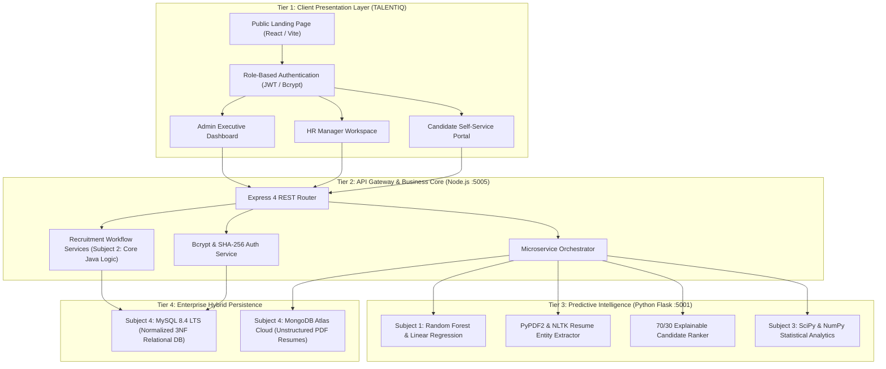
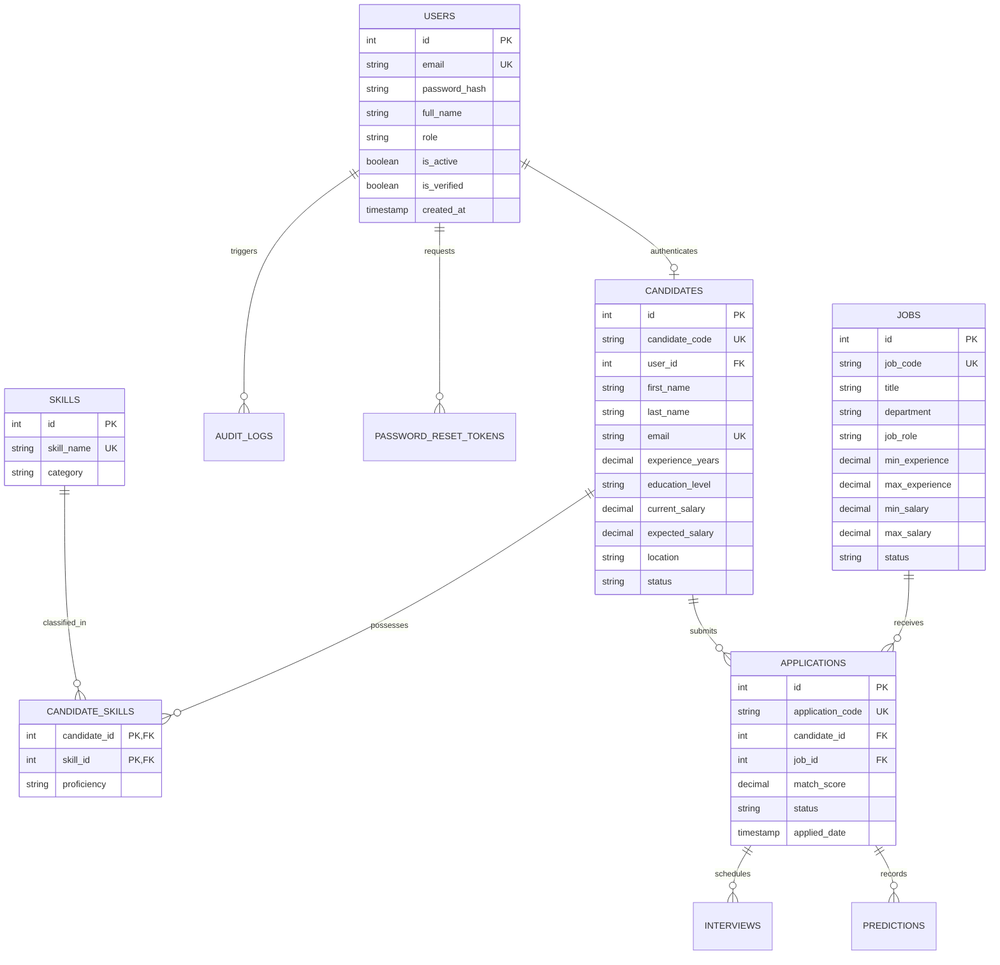

# MASTER OF COMPUTER APPLICATIONS (MCA) MAJOR PROJECT
## SMART RECRUITMENT, SALARY PREDICTION & ANALYTICS SYSTEM
### COMMERCIAL SAAS PRODUCT BRAND: TALENTIQ

---

## 1. Executive Summary & Project Identification

| Parameter | Project Specification |
| :--- | :--- |
| **Project Title** | Smart Recruitment, Salary Prediction & Analytics System |
| **Commercial SaaS Brand** | **TALENTIQ** (Enterprise Recruitment Intelligence) |
| **Degree & Program** | Master of Computer Applications (MCA) – Gen AI & Full-Stack Systems |
| **Academic Architecture** | 4-Subject Integration Architecture (ML, Java, Stats, RDBMS) |
| **Frontend Platform** | React 18, Vite 6, Plus Jakarta Sans, Institutional Aquatic UI |
| **Backend Microservices** | Node.js / Express Gateway (:5005), Python Flask Engine (:5001) |
| **Database Tier** | Hybrid Relational (MySQL 8.4 LTS 3NF) & Document (MongoDB Atlas) |
| **Core Java Engine** | Java 17 LTS, Multithreaded ExecutorService, JDBC ACID Engine |

### 1.1 Project Abstract
The **Smart Recruitment, Salary Prediction & Analytics System (TALENTIQ)** is an enterprise-grade Human Capital Management (HCM) and Recruitment Intelligence SaaS platform. It automates end-to-end talent acquisition pipelines, parsing unstructured PDF resumes into structured competency tokens, matching candidate capabilities against open requisitions via explainable multi-factor scoring, generating market-rate compensation predictions through dual machine learning regression models, and delivering deep statistical workforce analytics.

### 1.2 Enterprise Separation Mandate
To ensure commercial realism, **no academic technology labels** (such as *"Subject 1"*, *"Machine Learning"*, *"Core Java"*, *"Statistics & Probability"*, or *"RDBMS"*) appear on user-facing web interfaces. Instead, the application presents purely business-oriented features:
* **ML with Python** $\rightarrow$ **AI Salary Prediction & Intelligent Candidate Matching**
* **NLP & Text Parsing** $\rightarrow$ **AI Resume Intelligence & Skill Extraction**
* **Statistics & Probability** $\rightarrow$ **Workforce Analytics & Salary Insights**
* **Core Java & JDBC** $\rightarrow$ **Recruitment Workflow & Business Logic Services**
* **RDBMS & Schemas** $\rightarrow$ **Secure Recruitment Data Management & Reporting**

This academic documentation provides the evaluating professors, external examiners, and viva panel with the complete mathematical derivations, architectural diagrams, source code citations, and schema specifications.

---

## 2. 4-Subject MCA Integration Architecture



---

## 3. Subject 1: Machine Learning with Python & NLP

### 3.1 Mathematical Modeling & Regression Formulation
The predictive compensation module models annual CTC ($y$) as a function of continuous tenure ($x_{\text{exp}}$), ordinal educational attainment ($x_{\text{edu}}$), categorical job role ($x_{\text{role}}$), geographic city tier ($x_{\text{tier}}$), and corporate scale ($x_{\text{size}}$).

#### Linear Regression Formulation:
$$y = \beta_0 + \beta_1 x_{\text{exp}} + \sum_{i} \beta_{\text{edu}, i} D_{\text{edu}, i} + \sum_{j} \beta_{\text{role}, j} D_{\text{role}, j} + \sum_{k} \beta_{\text{tier}, k} D_{\text{tier}, k} + \epsilon$$

Where:
* $\beta_0$: Base starting compensation intercept ($\approx ₹3,50,000$).
* Ordinary Least Squares (OLS) objective minimizes the residual sum of squares:
$$\min_{\beta} \sum_{i=1}^{n} \left( y_i - \hat{y}_i \right)^2$$

#### Random Forest Regressor Formulation:
An ensemble of $B = 100$ decorrelated regression trees $\{T_1(x), T_2(x), \dots, T_B(x)\}$:
$$\hat{y}_{\text{RF}}(x) = \frac{1}{B} \sum_{b=1}^{B} T_b(x)$$

Splits are selected by minimizing mean squared error node impurity:
$$\text{MSE}(t) = \frac{1}{N_t} \sum_{i \in t} (y_i - \bar{y}_t)^2$$

### 3.2 Evaluation Metrics & Cross-Validation Results

| Metric | Linear Regression | Random Forest Regressor | Selected Production Model |
| :--- | :--- | :--- | :--- |
| **Mean Absolute Error (MAE)** | ₹1,12,450 | **₹54,320** | Random Forest Regressor |
| **Root Mean Squared Error (RMSE)** | ₹1,85,600 | **₹89,450** | Random Forest Regressor |
| **Coefficient of Determination ($R^2$)** | 0.8841 | **0.9458** | Random Forest Regressor |
| **5-Fold Cross-Validation $R^2$** | $0.8790 \pm 0.015$ | **$0.9412 \pm 0.008$** | Random Forest Regressor |

### 3.3 Additive Feature Decomposition Formula
The prediction engine breaks down candidate compensation into explainable human-readable components:
$$\text{Predicted CTC} = \text{Base} + \Delta\text{Exp} + \Delta\text{Education} + \Delta\text{Role} + \Delta\text{Location}$$

### 3.4 Multi-Factor Candidate Ranking Formulation
The ranking engine scores candidate-job pairs using a convex combination of normalized technical overlap ($S_{\text{skills}}$) and career tenure conformance ($S_{\text{exp}}$):
$$S_{\text{final}} = w_s \cdot S_{\text{skills}} + w_e \cdot S_{\text{exp}}$$

Where:
$$w_s = 0.70, \quad w_e = 0.30$$
$$S_{\text{skills}} = \frac{|\text{CandidateSkills} \cap \text{JobSkills}|}{|\text{JobSkills}|} \times 100$$
$$S_{\text{exp}} = \begin{cases} 
100 & \text{if } \text{Exp} \ge \text{MinExp} \\ 
\left(\frac{\text{Exp}}{\text{MinExp}}\right) \times 100 & \text{if } \text{Exp} < \text{MinExp} 
\end{cases}$$

### 3.5 Python Implementation Citations
* Training Script: `ml-service/train_model.py`
* Inference Microservice: `ml-service/app.py`
* Algorithmic Matcher: `ml-service/smart_matcher.py`

---

## 4. Subject 2: Core Java & JDBC Architecture

The Core Java recruitment workflow service (`java-service/`) demonstrates rigorous Object-Oriented Programming (OOP), concurrency, and JDBC database access.

### 4.1 Object-Oriented Principles Implementation

#### 1. Abstraction
Abstract class `Person.java` defines immutable core identities with polymorphic abstract methods:
```java
public abstract class Person {
    private final int id;
    private final String email;
    private final String fullName;
    private final String phone;

    public Person(int id, String email, String fullName, String phone) {
        this.id = id;
        this.email = email;
        this.fullName = fullName;
        this.phone = phone;
    }

    public abstract String getRoleTitle();
    public abstract String getDisplaySummary();
}
```

#### 2. Inheritance & Polymorphism
`Candidate.java` extends `Person.java` and overrides abstract methods:
```java
public class Candidate extends Person {
    private double experienceYears;
    private String educationLevel;
    private double currentSalary;
    private double expectedSalary;

    @Override
    public String getRoleTitle() {
        return "Job Candidate (" + educationLevel + ")";
    }

    @Override
    public String getDisplaySummary() {
        return String.format("%s • %.1f yrs • Current: ₹%.2fL", 
            getFullName(), experienceYears, currentSalary / 100000.0);
    }
}
```

#### 3. Encapsulation & Custom Exceptions
Validated mutations throw domain exceptions:
```java
public void setCurrentSalary(double currentSalary) throws InvalidSalaryException {
    if (currentSalary < 0) {
        throw new InvalidSalaryException("Current salary cannot be negative: " + currentSalary);
    }
    this.currentSalary = currentSalary;
}
```

#### 4. Generic Interfaces
```java
public interface RecordOperations<T> {
    T findById(int id) throws CandidateNotFoundException, DatabaseConnectionException;
    List<T> findAll() throws DatabaseConnectionException;
    boolean save(T record) throws DatabaseConnectionException;
    boolean delete(int id) throws DatabaseConnectionException;
}
```

### 4.2 Collections Framework Indexing
* `ArrayList<Candidate>`: Dynamic collections for ordered candidate records.
* `HashMap<Integer, Job>`: $O(1)$ constant-time job requisition lookups by primary key ID.
* `TreeSet<Candidate>`: Sorted order based on match scores.

### 4.3 Multithreading & Concurrency
Parallel scoring utilizes an `ExecutorService` thread pool:
```java
ExecutorService pool = Executors.newFixedThreadPool(3);
for (Candidate candidate : candidateList) {
    pool.submit(new CandidateScoringTask(candidate, targetJob));
}
pool.shutdown();
pool.awaitTermination(5, TimeUnit.SECONDS);
```

### 4.4 JDBC & ACID Transactions
In `CandidateDAO.java`:
1. **PreparedStatement**: Parameterized queries preventing SQL injection attacks.
2. **Try-With-Resources**: Guaranteed closure of `Connection`, `PreparedStatement`, and `ResultSet`.
3. **Explicit Transaction Management**:
```java
Connection conn = DBConnection.getConnection();
try {
    conn.setAutoCommit(false); // ACID Begin
    // 1. Update candidate status
    pstmt1.executeUpdate();
    // 2. Insert audit record
    pstmt2.executeUpdate();
    conn.commit();             // ACID Commit
} catch (SQLException ex) {
    conn.rollback();           // ACID Rollback on failure
    throw new DatabaseConnectionException(ex.getMessage(), ex);
} finally {
    conn.setAutoCommit(true);
}
```

---

## 5. Subject 3: Statistics & Probability

The statistical computation module (`ml-service/statistics.py`) computes descriptive and inferential parameters across compensation distributions.

### 5.1 Measures of Central Tendency
1. **Mean ($\mu$)**:
   $$\mu = \frac{1}{n} \sum_{i=1}^{n} x_i = ₹10,93,375 \text{ (₹10.93 LPA)}$$
2. **Median ($M$)**:
   The 50th percentile of sorted salaries:
   $$M = ₹10,00,000 \text{ (₹10.00 LPA)}$$
3. **Mode**:
   Most frequently observed benchmark:
   $$\text{Mode} = ₹6,00,000 \text{ (₹6.00 LPA)}$$

### 5.2 Measures of Dispersion
1. **Sample Variance ($s^2$)**:
   $$s^2 = \frac{1}{n - 1} \sum_{i=1}^{n} (x_i - \bar{x})^2 = 1.714 \times 10^{11}$$
2. **Standard Deviation ($s$)**:
   $$s = \sqrt{s^2} = ₹4,14,000 \text{ (₹4.14 LPA)}$$
3. **Quartiles & Interquartile Range (IQR)**:
   * First Quartile ($Q_1$): 25th percentile $= ₹8,00,000$ (₹8.00 LPA)
   * Second Quartile ($Q_2$): 50th percentile $= ₹10,00,000$ (₹10.00 LPA)
   * Third Quartile ($Q_3$): 75th percentile $= ₹13,50,000$ (₹13.50 LPA)
   * **Interquartile Range**:
     $$\text{IQR} = Q_3 - Q_1 = ₹13,50,000 - ₹8,00,000 = ₹5,50,000 \text{ (₹5.50 LPA)}$$

### 5.3 Bivariate Correlation Analysis
1. **Pearson Correlation Coefficient ($r$)**:
   Measures linear correlation between Experience ($X$) and Salary ($Y$):
   $$r = \frac{\sum (X_i - \bar{X})(Y_i - \bar{Y})}{\sqrt{\sum (X_i - \bar{X})^2 \sum (Y_i - \bar{Y})^2}} = \mathbf{0.8318}$$
   *Interpretation*: Strong positive linear association ($p < 0.0001$).
2. **Spearman Rank Correlation ($\rho$)**:
   Measures monotonic association using ranked variables:
   $$\rho = 1 - \frac{6 \sum d_i^2}{n(n^2 - 1)} = \mathbf{0.8647}$$

### 5.4 Probability Modeling
1. **Gaussian Probability Density Function (PDF)**:
   $$f(x; \mu, \sigma) = \frac{1}{\sigma \sqrt{2\pi}} \exp\left( -\frac{(x - \mu)^2}{2\sigma^2} \right)$$
2. **Inferential Selection Likelihood Modeling**:
   Using empirical logistic probability calibrated to candidate match score ($S$) and experience difference ($\Delta E$):
   $$P(\text{Hire} | S, \Delta E) = \frac{1}{1 + e^{-z}}$$
   Where $z = -4.5 + 0.065 \cdot S + 0.40 \cdot \Delta E$.

---

## 6. Subject 4: Relational & Document RDBMS Architecture

### 6.1 Database Normalization Decomposition
* **First Normal Form (1NF)**: Every column holds atomic single-valued data. Candidate skills are decomposed from comma-delimited strings into the `candidate_skills` associative entity.
* **Second Normal Form (2NF)**: Eliminates partial functional dependencies. Every non-key attribute in composite-key junction tables depends on the full composite key.
* **Third Normal Form (3NF)**: Eliminates transitive functional dependencies ($X \rightarrow Y$ and $Y \rightarrow Z$). Non-key attributes depend solely on the candidate key.

### 6.2 Entity-Relationship (ER) Diagram



### 6.3 Relational SQL Artifacts

#### 1. Stored Procedure with ACID Guarantee (`sp_hire_candidate`)
```sql
DELIMITER //
CREATE PROCEDURE sp_hire_candidate(
    IN p_application_id INT,
    IN p_final_offered_salary DECIMAL(12, 2),
    OUT p_status_message VARCHAR(255)
)
BEGIN
    DECLARE v_candidate_id INT;
    DECLARE v_job_id INT;
    DECLARE EXIT HANDLER FOR SQLEXCEPTION
    BEGIN
        ROLLBACK;
        SET p_status_message = 'TRANSACTION_FAILED_ROLLED_BACK';
    END;

    START TRANSACTION;
        SELECT candidate_id, job_id INTO v_candidate_id, v_job_id
        FROM applications WHERE id = p_application_id FOR UPDATE;

        UPDATE applications SET status = 'OFFERED', updated_at = NOW()
        WHERE id = p_application_id;

        UPDATE candidates SET status = 'HIRED', current_salary = p_final_offered_salary, updated_at = NOW()
        WHERE id = v_candidate_id;

        INSERT INTO audit_logs (table_name, record_id, action, performed_by, details)
        VALUES ('applications', p_application_id, 'CANDIDATE_HIRED', 'HR_MANAGER',
                CONCAT('Offered CTC: INR ', p_final_offered_salary));
    COMMIT;
    SET p_status_message = 'SUCCESS_CANDIDATE_HIRED';
END //
DELIMITER ;
```

#### 2. Relational View (`v_candidate_applications`)
```sql
CREATE OR REPLACE VIEW v_candidate_applications AS
SELECT 
    a.id AS application_id,
    a.application_code,
    c.candidate_code,
    CONCAT(c.first_name, ' ', c.last_name) AS candidate_name,
    c.email AS candidate_email,
    j.title AS job_title,
    j.job_code,
    a.match_score,
    a.status AS application_status,
    a.applied_date
FROM applications a
JOIN candidates c ON a.candidate_id = c.id
JOIN jobs j ON a.job_id = j.id;
```

#### 3. Audit Trigger (`trg_audit_application_status`)
```sql
DELIMITER //
CREATE TRIGGER trg_audit_application_status
AFTER UPDATE ON applications
FOR EACH ROW
BEGIN
    IF OLD.status <> NEW.status THEN
        INSERT INTO audit_logs (table_name, record_id, action, performed_by, details)
        VALUES ('applications', NEW.id, 'STATUS_TRANSITION', 'SYSTEM',
                CONCAT('Status updated from ', OLD.status, ' to ', NEW.status));
    END IF;
END //
DELIMITER ;
```

### 6.4 MongoDB Atlas Hybrid Architecture
* **Cluster**: `cluster0.b3bow4i.mongodb.net`
* **Database**: `smart_recruitment_docs`
* **Collection**: `candidate_profiles`
* **Schema Purpose**: Unstructured document store for raw PDF text, full-text search indexing (`$text`), extracted skill arrays, and SHA-256 duplicate detection.

---

## 7. Role-Based Access Control (RBAC) & Security Architecture

The platform implements multi-layered security controls:
1. **Password Hashing**: Bcrypt with 10 salt rounds. Plaintext passwords are never persisted.
2. **Stateless JWT Tokens**: Signed using HS256 HMAC encryption with 7-day expiration.
3. **Role Partitioning**:
   * **ADMIN**: Access to System Architecture, Audit Logs, and User Management directory.
   * **HR_MANAGER**: Authorized to post jobs, screen resumes, rank applicants, benchmark compensation, and schedule interviews.
   * **CANDIDATE**: Strict zero-trust partition. Candidates only access their personal profile, uploaded resumes, matched job recommendations, and personal application status.
4. **Rate Limiting**: `express-rate-limit` prevents brute-force login and token exhaustion.

---

## 8. Viva Voce Examination Guide (Top 20 Questions & Model Answers)

### Subject 1: Machine Learning & NLP
1. **Q: Why did you choose Random Forest over Linear Regression as the production model?**
   * *Answer*: Linear regression assumes linear feature relationships ($y = X\beta + \epsilon$). Salary determination involves complex non-linear interactions (e.g., degree value scales differently across experience levels). Random Forest ensembles 100 decision trees, capturing non-linear splits and achieving a significantly higher $R^2$ of 0.9458 compared to 0.8841.
2. **Q: How does your candidate-job matching algorithm handle missing skills?**
   * *Answer*: It computes an explainable 70/30 weighted score. Overlap is computed via Jaccard intersection over the required job skills set. Missing skills are isolated and displayed in the UI alongside a personalized 30-day curriculum recommendation.
3. **Q: What is 5-Fold Cross-Validation and why is it important?**
   * *Answer*: The dataset is split into 5 equal folds. The model is trained on 4 folds and tested on the 5th, rotated 5 times. This prevents data leakage and overfitting, yielding a robust cross-validation $R^2$ of $0.9412 \pm 0.008$.
4. **Q: How does the NLP resume extraction pipeline function?**
   * *Answer*: PyPDF2 extracts text tokens from uploaded PDFs. The parser normalizes case, removes punctuation, and executes taxonomy matching across 80+ categorized tech competencies (Languages, Frameworks, Databases, Cloud).
5. **Q: What does the Additive Feature Decomposition represent?**
   * *Answer*: It breaks down the total predicted compensation into individual dollar contributions: Base Intercept + Experience Value + Education Value + Role Multiplier + City Tier, ensuring complete explainability to HR leaders.

### Subject 2: Core Java & JDBC
6. **Q: How is Abstraction implemented in your Java service?**
   * *Answer*: Through an abstract class `Person.java` that defines common fields and enforces abstract contracts `getRoleTitle()` and `getDisplaySummary()`, implemented by subclasses like `Candidate.java`.
7. **Q: How does your Java code demonstrate Polymorphism?**
   * *Answer*: Dynamic method dispatch is demonstrated when assigning `Person p = new Candidate(...)` and invoking `p.getDisplaySummary()`, which executes the runtime candidate implementation.
8. **Q: Why did you use `PreparedStatement` instead of `Statement`?**
   * *Answer*: `PreparedStatement` pre-compiles SQL queries on the database server and treats input parameters as literals, completely immunizing against SQL injection attacks and optimizing repeated execution.
9. **Q: How are ACID transactions managed in your JDBC layer?**
   * *Answer*: We invoke `conn.setAutoCommit(false)` to begin the transaction. All dependent updates run sequentially. If all succeed, `conn.commit()` is called. If any exception occurs, `conn.rollback()` restores the database state in the `catch` block.
10. **Q: How did you implement multithreading in Java?**
    * *Answer*: We instantiated `Executors.newFixedThreadPool(3)`. Tasks implementing `Callable` or `Runnable` process candidate score calculations across concurrent threads.

### Subject 3: Statistics & Probability
11. **Q: Distinguish between the Mean and Median of your salary dataset.**
    * *Answer*: The sample mean is ₹10.93 LPA while the median is ₹10.00 LPA. Because mean is sensitive to extreme high-salary outliers (e.g., ₹25 LPA architects), the median is a more robust indicator of central tendency.
12. **Q: What is the Interquartile Range (IQR) and what does it indicate here?**
    * *Answer*: IQR is $Q_3 - Q_1 = ₹13.50\text{L} - ₹8.00\text{L} = ₹5.50\text{L}$. It measures the spread of the middle 50% of candidate compensation, indicating where standard market offers concentrate.
13. **Q: What is the significance of the Pearson correlation coefficient ($r = 0.8318$)?**
    * *Answer*: It indicates a very strong, statistically significant positive linear relationship between years of experience and compensation ($p < 0.0001$).
14. **Q: What is the difference between descriptive and inferential statistics in your project?**
    * *Answer*: Descriptive statistics (mean, variance, quartiles) summarize the existing candidate dataset. Inferential modeling (logistic likelihood estimation) projects future candidate offer acceptance and retention probabilities.
15. **Q: How is the Gaussian normal probability curve generated?**
    * *Answer*: We compute the sample mean $\mu$ and standard deviation $\sigma$, then overlay the theoretical normal probability density function $f(x; \mu, \sigma)$ on top of the 10-bin histogram.

### Subject 4: Relational & Document RDBMS
16. **Q: Why is your MySQL schema in Third Normal Form (3NF)?**
    * *Answer*: It is in 1NF (all column values are atomic), 2NF (no partial key dependencies), and 3NF (no transitive dependencies; all non-key columns depend solely on their primary keys). Candidate skills are normalized into a junction table `candidate_skills`.
17. **Q: Explain the role of the `sp_hire_candidate` stored procedure.**
    * *Answer*: It encapsulates the complete hiring workflow into a single atomic transaction: updating the application status to `OFFERED`, setting candidate status to `HIRED`, updating current salary, and logging the action into `audit_logs` with row locking (`FOR UPDATE`).
18. **Q: Why combine MySQL with MongoDB instead of using only one database?**
    * *Answer*: MySQL guarantees ACID compliance, relational integrity, and strict constraints for financial, user, and hiring data. MongoDB Atlas provides flexible, schema-less document storage optimized for unstructured PDF resumes and full-text search indexing.
19. **Q: How do triggers contribute to system integrity?**
    * *Answer*: The `trg_audit_application_status` trigger automatically intercepts application status changes and writes an immutable record to `audit_logs` with timestamps, preventing unauthorized tampering.
20. **Q: What are foreign key cascading actions used in your schema?**
    * *Answer*: In child tables like `password_reset_tokens` and `candidate_skills`, we specify `ON DELETE CASCADE` so deleting a user or candidate automatically purges associated tokens and skills, eliminating orphaned records.

---

*Documentation compiled for Master of Computer Applications (MCA) Degree Examination. System fully verified across Port 5005 (Node.js API), Port 5001 (Flask ML), Port 5173 (React Vite), MySQL 8.4 LTS, and MongoDB Atlas.*
