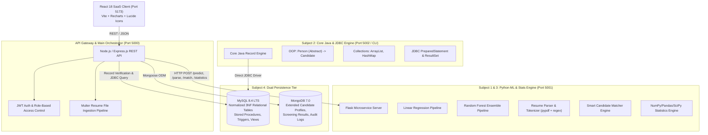
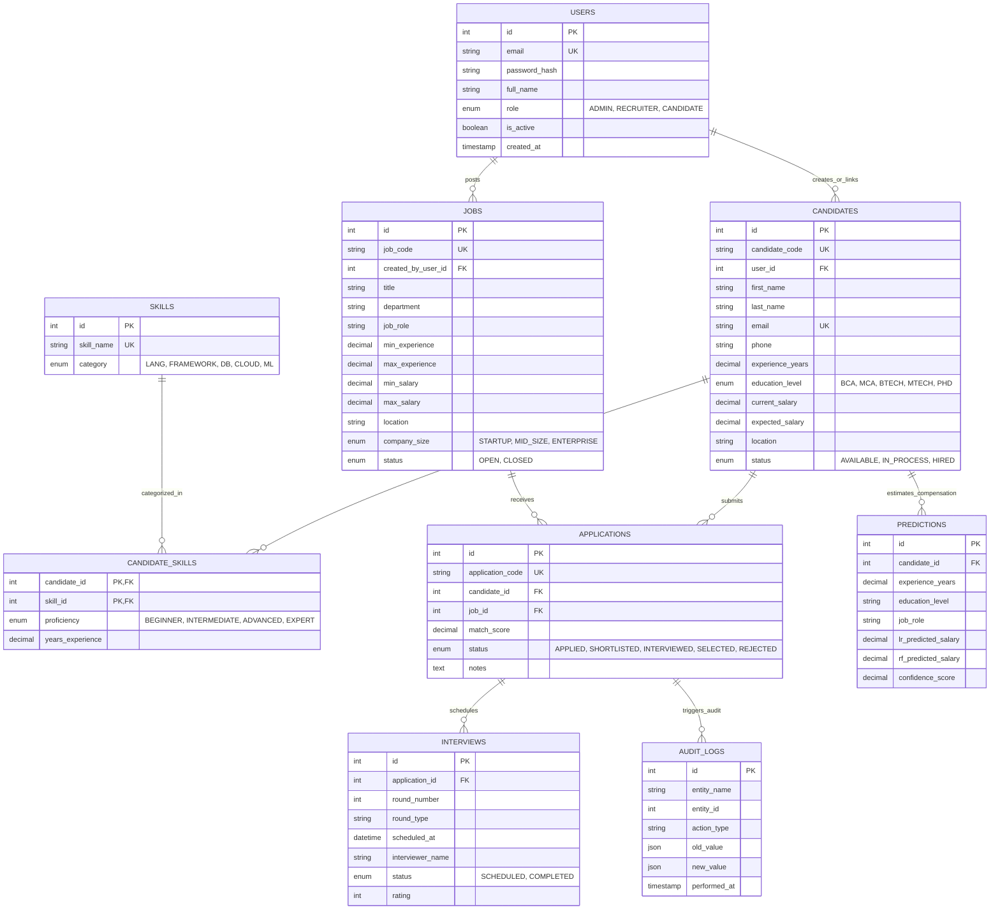
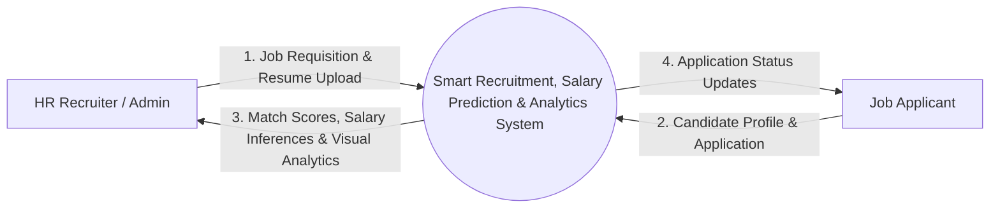
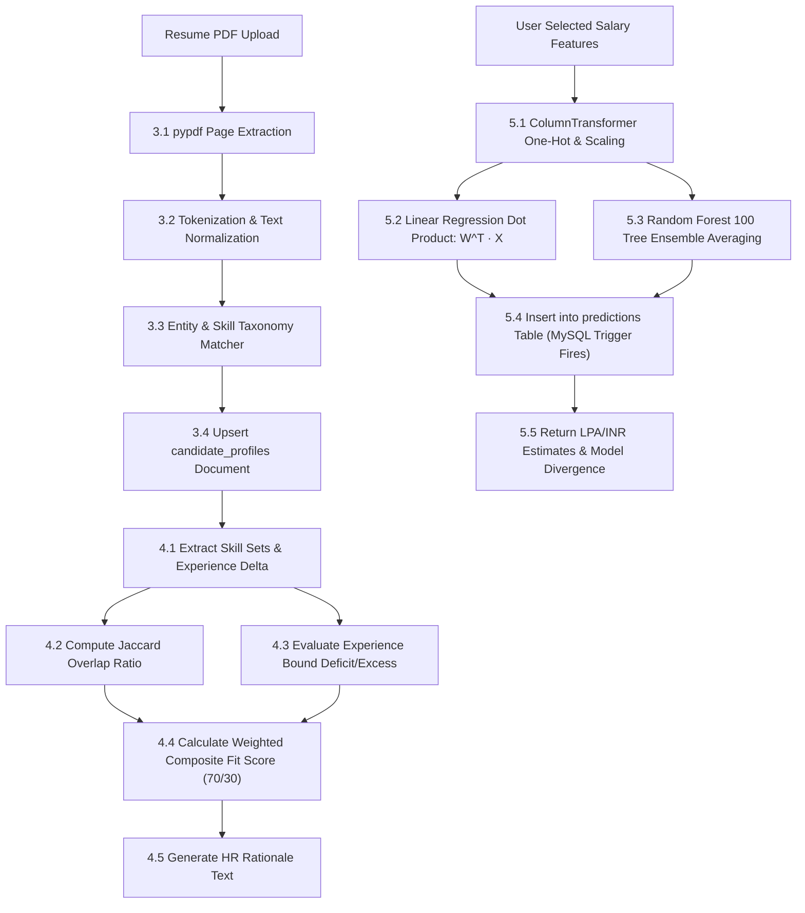
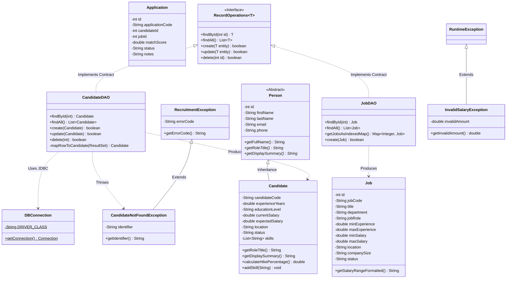
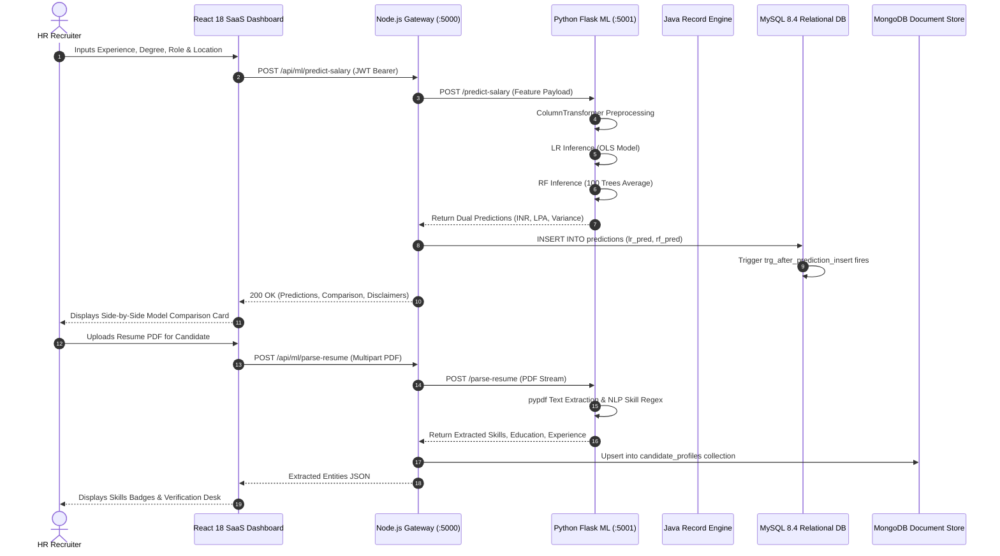

# System Architecture & Diagrammatic Specifications

## 1. High-Level Polyglot Architecture



---

## 2. Entity-Relationship (ER) Diagram (MySQL 8.4 3NF Schema)



---

## 3. Data Flow Diagrams (DFD)

### DFD Level 0 (Context Diagram)



### DFD Level 1 (Sub-system Breakdown)

```mermaid
flowchart TD
    User["HR Manager / Admin"] -->|Credentials| P1["1.0 Authentication & RBAC"]
    P1 -->|JWT Session| P2["2.0 Candidate & Job Management"]
    
    User -->|Resume PDF / Text| P3["3.0 Resume Screening & NLP Extraction"]
    P3 -->|Parsed Skills & Exp| D1[("MongoDB Document Store")]
    
    P3 -->|Candidate Features| P4["4.0 Smart Candidate-Job Matching"]
    P2 -->|Job Requirements| P4
    P4 -->|Match Score & Rationale| User
    
    User -->|Experience, Degree, Role| P5["5.0 Salary Prediction Regressors"]
    P5 -->|LR & RF Predictions| D2[("MySQL 8.4 Relational Core")]
    P5 -->|Compensation Estimates| User
    
    D2 -->|Historical Salary Data| P6["6.0 Statistical & Probability Engine"]
    P6 -->|Mean, StdDev, Pearson r, P(Hire)| User
```

### DFD Level 2 (Resume Screening & Prediction Engine Detailed Flow)



---

## 4. UML Class Diagram (Subject 2: Core Java OOP Architecture)



---

## 5. Sequence Diagram: Prediction & Smart Matching Lifecycle


